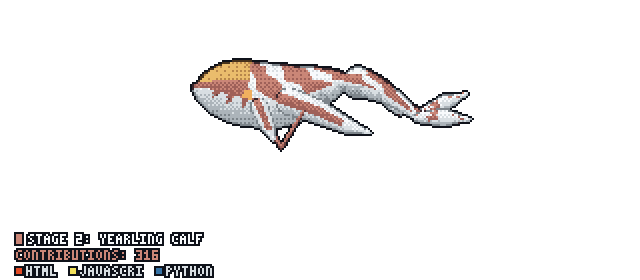

# LucasEntweihen

  

  <b>Peixe procedural pixel-art — Tulkun</b> gerado a partir da atividade do GitHub.

---

## 📊 Commits dos meus projetos

  
  

---

## 🔗 Meus projetos e organizações

### Projetos pessoais

- [LucasEntweihen/oh-my-shark](https://github.com/LucasEntweihen/oh-my-shark) — Coding agent terminal-first.
- [LucasEntweihen/Universidade-Log](https://github.com/LucasEntweihen/Universidade-Log) — Plataforma de estudo gamificada, 100% estática e gratuita.

### Organizações

- [Efficientia](https://github.com/Efficientia) — Ecossistema de inteligência artificial e automação.
  - [Efficientia/Efficientia-IA-desktop](https://github.com/Efficientia/Efficientia-IA-desktop) — Sistema de IA para desktop com FastAPI, LangGraph e guardrails de segurança.

- [Fluxar-NeoTech](https://github.com/Fluxar-NeoTech) — Aplicação para otimização de trabalho e gestão de estoques industriais.

---

## 🐟 Sobre o Tulkun

Procedural pixel-art Tulkun gerado a partir das contribuições do GitHub, com cores das linguagens de programação usadas nos projetos.
